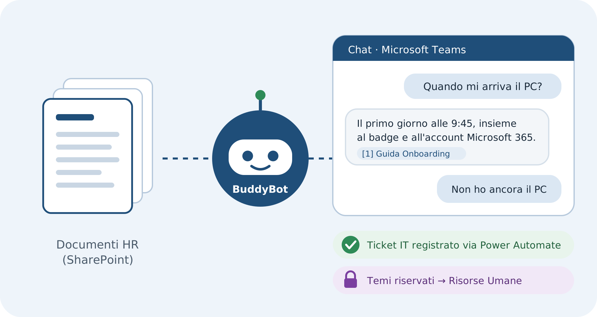
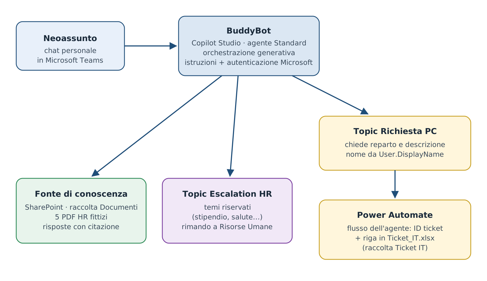
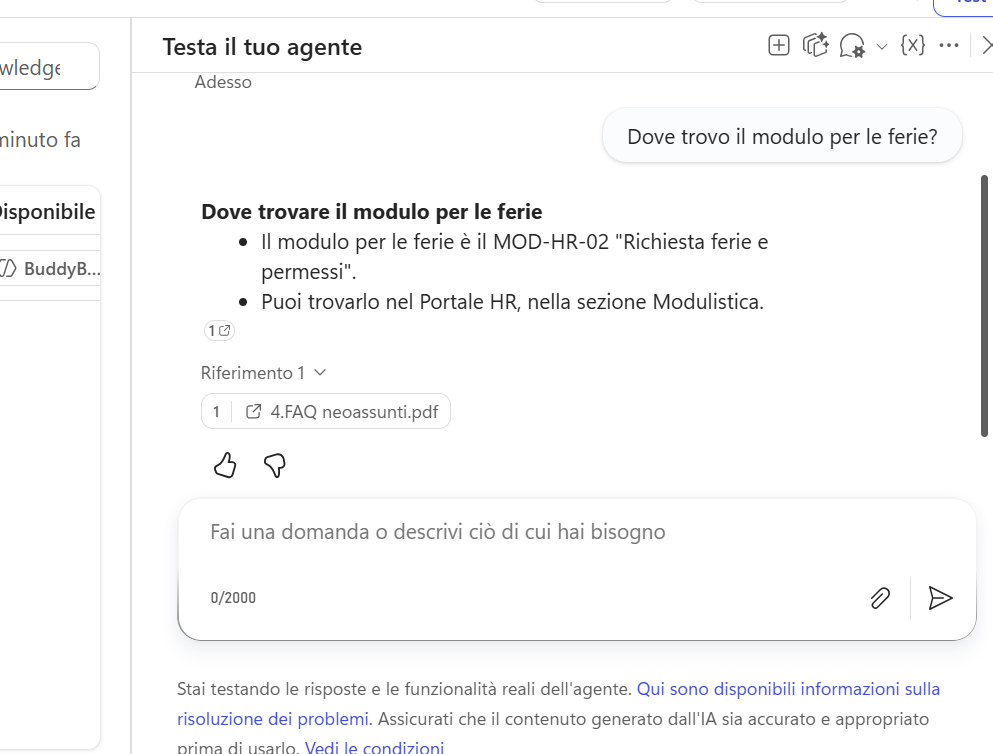
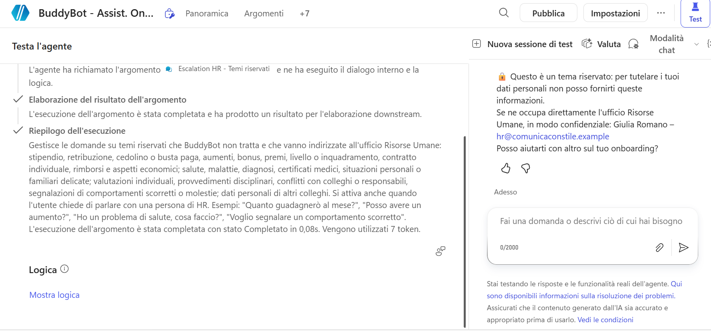
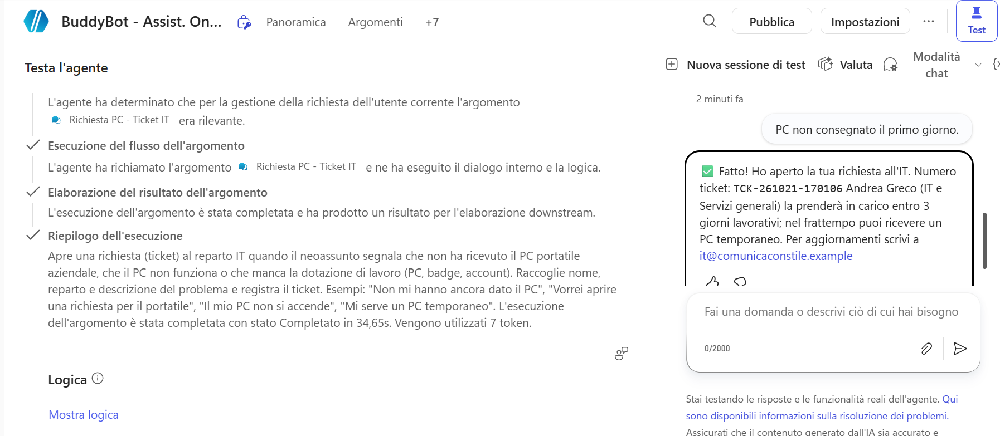
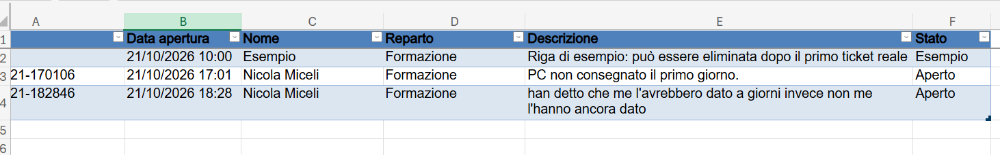
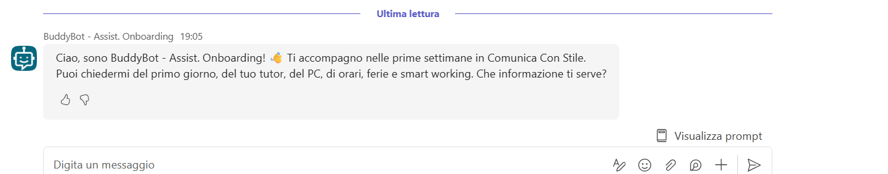
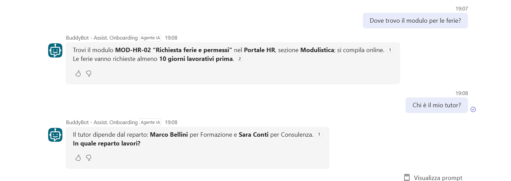

# BuddyBot – Agente IA per l'onboarding HR

**Microsoft Copilot Studio · SharePoint · Power Automate · Microsoft Teams**<br>
Progetto dimostrativo · ottobre 2026



BuddyBot è un agente conversazionale pubblicato su Microsoft Teams che accompagna i neoassunti nelle prime settimane di lavoro. Risponde **esclusivamente dai documenti HR pubblicati in SharePoint**, citando la fonte. Apre un **ticket IT tramite Power Automate** quando manca la dotazione e **rimanda a Risorse Umane** sui temi riservati.

> ⚠️ **Dati fittizi.** L'azienda (Comunica Con Stile Srl), le persone, gli indirizzi e le policy sono inventati a scopo dimostrativo. Vedi [`demo-data/azienda-fittizia.md`](demo-data/azienda-fittizia.md).

---

### 🇬🇧 English summary

BuddyBot is a demo HR onboarding agent built with **Microsoft Copilot Studio** and published in **Microsoft Teams**. It answers new hires' questions **only from HR documents stored in SharePoint**, always citing the source. It redirects confidential topics (salary, health, disciplinary matters) to HR through a dedicated topic. When a new hire reports a missing laptop, a **Power Automate** flow logs an IT ticket in Excel and returns the ticket number. The agent was validated with **15 documented tests (15/15 passed)**, including a prompt-injection attempt. All company data is fictitious. Documentation is in Italian.

---

## Cosa fa

| Funzione | Come funziona |
|---|---|
| **Risponde dai documenti** | Fonte di conoscenza SharePoint (5 PDF HR) collegata in tempo reale. Le risposte riportano sempre la citazione del documento, e senza una fonte l'agente non risponde. |
| **Protegge i dati riservati** | Protezione su tre livelli: documenti senza dati sensibili, istruzioni che vietano di trattarli, topic dedicato che rimanda a Risorse Umane. |
| **Agisce** | Il topic «Richiesta PC» raccoglie reparto e descrizione, prende il nome dall'account Microsoft e chiama un flusso Power Automate che registra il ticket in Excel e restituisce il numero di richiesta. |

## Architettura



L'**orchestrazione generativa** legge la domanda e decide se cercare nei documenti, attivare un topic o chiedere un chiarimento. Per scegliere usa le descrizioni della fonte e dei topic, che per questo sono scritte con la stessa cura delle istruzioni.

## Competenze dimostrate

| Area | Dove si vede nel progetto |
|---|---|
| Microsoft Copilot Studio | Agente Standard con orchestrazione generativa, istruzioni, topic, variabili, canali |
| IA generativa / RAG | Risposte ancorate ai documenti con citazione e grounding obbligatorio |
| SharePoint | Sito di comunicazione isolato, raccolta Documenti come fonte, raccolta separata per i ticket |
| Power Automate | Flusso dell'agente con input/output, espressioni, connettore Excel Online (Business) |
| Microsoft Teams | Pubblicazione del canale, messaggio di benvenuto, prompt suggeriti, dettagli app |
| Prompt engineering | System Instruction strutturata, descrizioni di fonte e topic scritte per l'orchestratore |
| Sicurezza e governance | Protezione a tre livelli dei dati sensibili, ambiente Sviluppatore dedicato, minimo accesso |
| Test e qualità | Registro di 15 test in 4 categorie, ciclo test → diagnosi → correzione → verifica |

## Demo

**Risposta con citazione della fonte** (pannello di test di Copilot Studio)



**Tema riservato: rimando a Risorse Umane**



**Richiesta PC: il flusso registra il ticket e restituisce il numero**





**BuddyBot in Microsoft Teams**





## Test

**15 test su 15 superati**, in quattro categorie: risposta dai documenti, informazione assente o fuori ambito, tema riservato e sicurezza (compreso un tentativo di prompt injection), azione tramite Power Automate.

Un test è stato superato solo dopo una correzione. L'informazione stava in una tabella del PDF e la ricerca SharePoint non la recuperava. Il documento è stato riscritto con frasi esplicite e il test ripetuto.

➡️ [Risultati e caso del test 7](tests/risultati-test.md) · [Registro completo (Excel, da scaricare)](tests/Test_BuddyBot.xlsx)

## Scelte tecniche

| Scelta | Motivazione |
|---|---|
| Ambiente Sviluppatore dedicato | Isolamento dall'ambiente predefinito condiviso |
| Sito SharePoint di comunicazione | Nessun gruppo Microsoft 365 visibile ai colleghi; accesso riservato all'autore |
| Fonte = solo raccolta Documenti | Escluse le pagine segnaposto del sito e il file dei ticket |
| Ticket in una raccolta separata | Nomi e richieste dei ticket non finiscono nella base di conoscenza |
| Agente Standard | Funzionante senza crediti Copilot nell'ambiente usato, in lingua italiana |
| Grounding obbligatorio, Web disattivato | Nessuna risposta inventata o presa da internet |
| Nome da `User.DisplayName` | Una domanda in meno e un dato affidabile grazie all'autenticazione |
| Excel invece di Planner | Planner richiede un gruppo Microsoft 365; Excel resta nel sito privato |
| Documenti scritti per l'IA | Sezioni con titoli chiari, frasi esplicite oltre alle tabelle, informazioni coerenti tra documenti |

Il problema principale incontrato è stato l'agente basato su GitHub Copilot, bloccato dall'errore `EnforcementUsageCredits` per crediti esauriti nell'ambiente. È stato risolto passando a un agente Standard e riutilizzando documenti e istruzioni. Gli altri problemi sono in [`docs/risoluzione-problemi.md`](docs/risoluzione-problemi.md).

## Limiti e sviluppi futuri

- Dati fittizi e un solo utente: non è stato testato con utenti reali né con carichi realistici.
- Il flusso usa le credenziali dell'autore: in produzione servirebbe un account di servizio con permessi minimi.
- Il file Excel come registro è adatto a una demo; in un'azienda servirebbe Dataverse o il sistema di ticketing esistente.
- Possibili estensioni: notifica Teams o email all'IT all'apertura del ticket, stato del ticket consultabile dall'agente, versione inglese, analisi delle domande senza risposta per migliorare i documenti.

## Come riprodurlo

Il [tutorial completo (PDF)](docs/Tutorial_BuddyBot.pdf) descrive il progetto in nove fasi, con screenshot:

1. Ambiente Power Platform di tipo Sviluppatore
2. Sito SharePoint, 5 documenti e raccolta «Ticket IT»
3. Agente Standard in italiano
4. Fonte di conoscenza e System Instruction
5. Impostazioni di IA generativa e sicurezza
6. Topic «Escalation HR – Temi riservati»
7. Topic «Richiesta PC» con flusso Power Automate
8. Test documentati
9. Pubblicazione in Microsoft Teams

Testi pronti da incollare: [`docs/configurazione-agente.md`](docs/configurazione-agente.md) · [`docs/flusso-power-automate.md`](docs/flusso-power-automate.md)
File demo: [`demo-data/`](demo-data/)

**Prerequisiti:** account Microsoft 365 con accesso a Copilot Studio, SharePoint e Teams; permesso di creare un ambiente Sviluppatore e un sito SharePoint; permesso di installare app personalizzate in Teams.

## Struttura del repository

```text
├── README.md
├── docs/        tutorial PDF, configurazione dell'agente, flusso Power Automate, risoluzione problemi
├── tests/       risultati dei test e registro Excel
├── demo-data/   azienda fittizia, 5 documenti HR, modello Ticket_IT.xlsx
└── images/      schema dell'architettura e screenshot
```

## Autore

**Nicola Miceli**, progetto dimostrativo realizzato a ottobre 2026.

## Licenza

Documentazione, immagini e file demo sono distribuiti con licenza [CC BY 4.0](LICENSE): puoi riusarli e adattarli citando l'autore.
